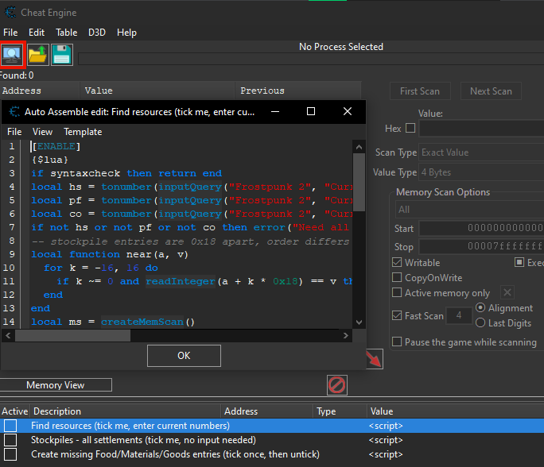

# Frostpunk 2 Cheat Table

Due to a bug I got in a playthrough I was very invested into, I needed a CT
table for Frostpunk 2, and due to none of the available ones working I built this,
in order to fix my issue, but it spiraled into a whole reverse engineering project itself.
Feel free to use it as you wish, do not distribute.
The table lets you view and edit
resources for both the main city and each colony.

Unlike most tables, it doesn't depend on hard-coded addresses.
It finds the game's own data structures by searching for code patterns,
reads resource names straight from the engine, and builds the list of 
settlements automatically. Changing saves or adding colonies works.

It may need revisiting in the future

## What you can edit

- **Shared resources:** Heatstamps, Prefabs, Cores
- **Per settlement:** Food, Materials, Goods and their storage capacity
- **Guard squads** per settlement
- **Missing entries:** if a colony has never had Food, Materials or Goods, the table can create the entry so you can set a value

## How to use it

1. Install [Cheat Engine](https://www.cheatengine.org/).
2. Start Frostpunk 2 and load a save.
3. Open `Frostpunk2.ct` in Cheat Engine and attach it to `Frostpunk2-Win64-Shipping.exe`.
4. Tick **Stockpiles - all settlements**. A group appears for the main city and for each colony.
5. Double-click a value to change it.

If a colony shows "(none in this stockpile yet)" for Food, Materials or Goods, tick **Create missing Food/Materials/Goods entries** once and then untick it. The entries are created with a value of 0, and you can edit them like the rest.

### Notes

- In game, Heatstamps, Prefabs and Cores show the total across all settlements. The table edits the main city's share, and the entry name shows the current total.
- **Find resources** is a simpler, older method. Tick it and enter your current Heatstamps, Prefabs and Cores, and it locates those three values. Use it if the main script stops working after a game update.
- Back up your save before editing anything.
- This is for single-player use only.

## How it works

See [TECHNICAL.md](TECHNICAL.md) for a breakdown of the reverse-engineering and how the script finds and edits the game's data.
